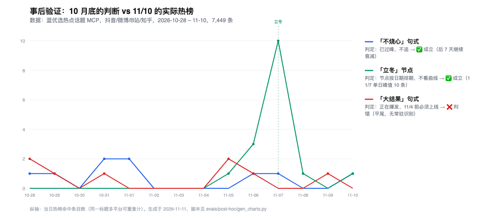
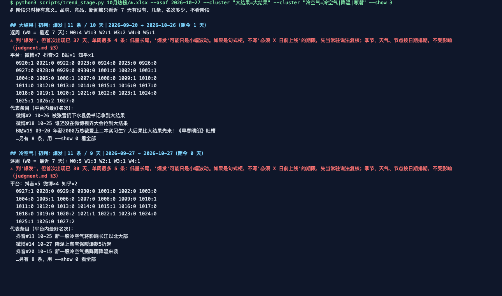

# 事后验证（2026-11-11）

10 月 28 / 29 日的三个案例里，有一部分判断 12 天后可以用数据检验。这里用蓝优选热点话题 MCP 拉了 **2026-10-28 至 11-10 共 14 天、7,449 条**热榜（抖音 1,193 / 微博 4,066 / 知乎 1,536 / B站 654），逐条比对当时的结论。

| 当时的判断 | 数据怎么说 | 判定 |
|---|---|---|
| 「不烧心」已过峰，不追 | 前 7 天 6 条 → 后 7 天 3 条，继续衰减 | ✅ |
| 安踏：立冬是节点，按日期排期 | 11/5 前 0 条，11/5 起 1 → 3 → 11/7 单日 10 条，11/8 后回落 | ✅ |
| 星巴克：冷空气 × 热饮，窗口够 | 10/30–11/10 持续在榜，到 11/10 仍未衰退 | ✅ |
| 「消费入座」是星巴克最大前提 | 10/29、10/30、11/1、11/3 持续在榜，11/3 老人争执双条 | ✅（持续时长被低估） |
| 万圣节来不及，跳过 | 10/31 起仅 3 条 | ✅ |
| 双 11 被平台占满，跳过 | 19 条里 16 条在微博，几乎全是天猫、京东、淘宝促销 | ✅ |
| 姆巴佩事件红线，跳过 | 10/28 单日 41 条，10/31 后归零 | ✅ |
| 安踏：「拿到大结果」正在爆发，11/2–11/4 前必须上线 | 两周各 4 条，不涨不跌 | ❌ |

## 判错的那条

「大结果」是常驻句式，不是爆发中的梗。10/27 时它 37 天里只有 11 条、单周最多 4 条，最近一周比前一周多 1 条就被判了爆发。旧的常驻识别要求"5 周以上每周都有、周中位数 ≥ 2"，它中间有一周是 0，没拦住。

`scripts/trend_stage.py` 已改（只加提示，不改阶段判定）：
- 判"爆发"但首次出现已超过 28 天、单周从没超过 5 条：提示"低量长尾"，句式梗不写上线期限。**用 10/27 当时的数据就能拦下「大结果」**（下图）
- 原常驻规则保留，再补一条短跨度规则：跨度 ≥ 10 天、周环比 0.75–1.5 倍。衰退中的簇不会误报
- 不到 10 条的簇，强制提示"不能只凭曲线判爆发"

**回归**：10 月数据重跑，所有簇的阶段判定不变（「不烧心」衰退、「可可」顶峰、「双 11」衰退、「万圣」样本不足）；「含金量」「纯过日子」「跑步」仍提示常驻。11 月数据重跑，「大结果」提示常驻，「不烧心」仍判衰退。

## 没证明什么

- 没有一条"追"真的上线过。验证的是判断对不对，不是上线效果
- 海外（ROX）没有可回查的逐日热榜，无法同法验证
- "没被做烂"一维仍没有饱和度工具

图表脚本：`python3 gen_charts.py <热榜 JSON>`（原始数据不随仓库发布）。
